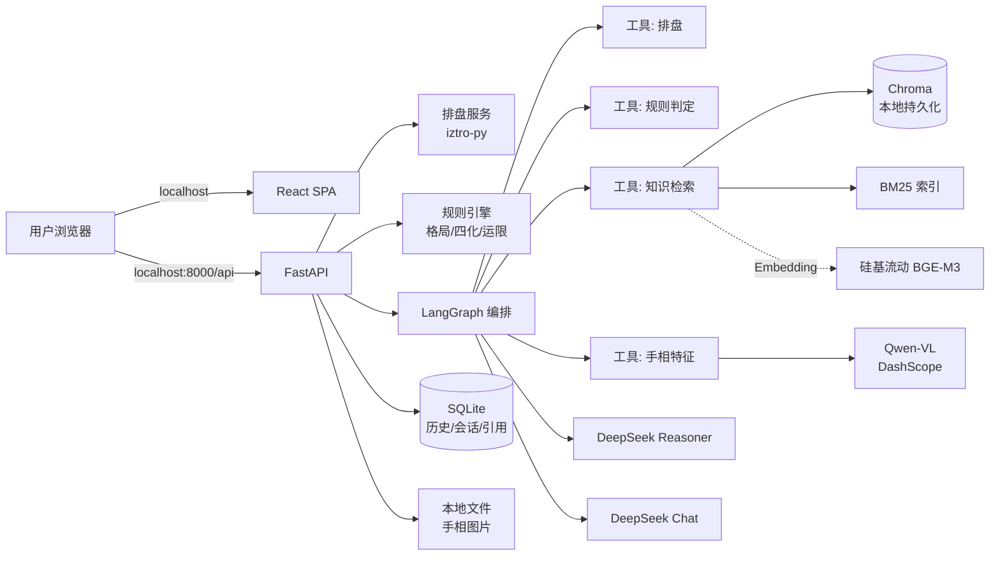
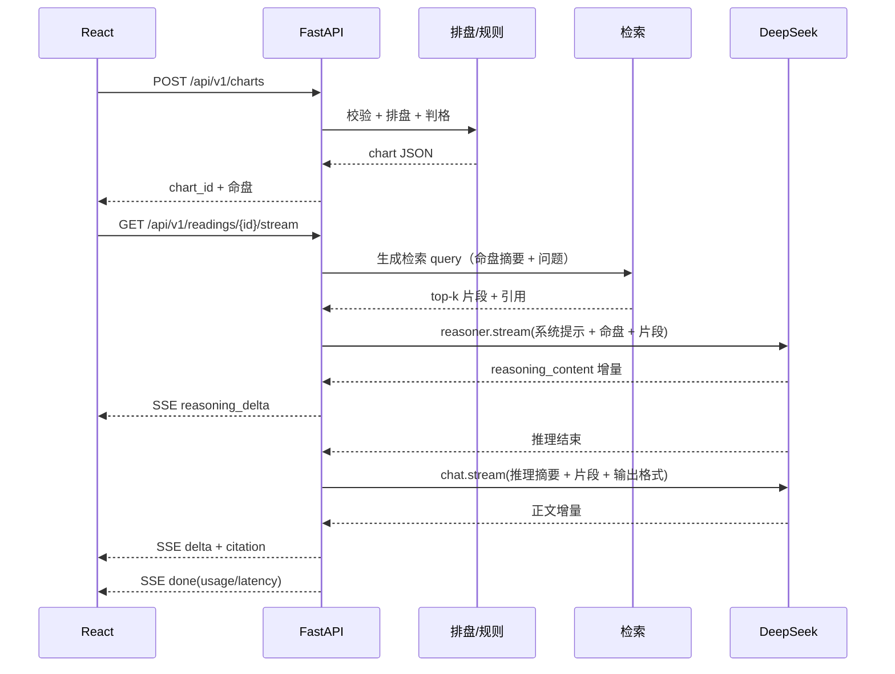

# 紫微斗数 AI 命盘推理系统 · 项目计划书

| 项目代号 | `ziwei-insight` |
|---|---|
| 版本 | v1.0 |
| 日期 | 2026-11-04 |
| 状态 | 规划阶段（本次仅交付文档） |
| 形态 | Web 应用 · 单人使用 · 作品集项目 |
| 一句话 | 输入生辰，确定性排盘 + 规则引擎判格局 + RAG 检索命理知识 + DeepSeek 流式推理，React 动画呈现一张“会自己长出来”的命盘。 |

---

## 1. 项目概述

### 1.1 产品目标

1. 用户输入公历/农历生日、时辰、性别、出生地，系统在 1 秒内生成准确的紫微斗数十二宫命盘。
2. 系统先做**确定性计算**（排盘、四化、大限、流年、格局），再把结构化结果交给大模型做**有依据的解读**。
3. 解读过程**流式输出**：推理链、正文、引用来源逐段出现，前端配合动画呈现。
4. 每个结论都能追溯到知识库中的原文或规则，不允许模型凭空编造星曜位置。
5. 支持多轮追问，追问时保持当前命盘上下文。

### 1.2 技术目标（作品集导向）

这个项目的核心不是“算命”，而是展示一条完整的 LLM 应用工程链路：

| 能力 | 在本项目中的落点 |
|---|---|
| Prompt Engineering | 系统提示词分层、少样本示例、结构化输出约束、拒答策略 |
| Context 管理 | 命盘摘要压缩、检索片段 token 预算、多轮历史裁剪 |
| Streaming | SSE 增量推送 `reasoning_content` 与正文，前端打字机渲染 |
| Tool Calling | 排盘、规则判定、知识检索封装为可调用工具 |
| RAG | 结构化切分、混合检索（向量 + BM25）、重排、引用、评测 |
| Agent 编排 | LangGraph 状态机：排盘 → 判格 → 检索 → 推理 → 成文 |
| 结构化输出 | Pydantic + JSON Schema 校验，失败自动修复 |
| 评测 | 黄金命盘回归 + RAGAS + 人工评分 + LLM-as-Judge |
| 可观测性 | 链路追踪、token/成本/延迟指标、结构化日志 |
| 可靠性 | 超时、重试、降级模型、限流、缓存、幂等 |
| 安全 | 密钥隔离、Prompt 注入防护、PII 最小化、免责声明 |

### 1.3 已确认的产品边界

- **运行方式**：只在本机运行，不做公网部署、不做容器化上线；GitHub 公开仓库用于展示代码与文档。
- **历史记录**：需要持久化，保存命盘、解读、对话、手相分析结果，支持查看与删除。
- **手相**：需要支持用户上传手相照片，因此引入独立的视觉模型（DeepSeek 文本 API 不支持图像输入）。
- **倪海厦模式**：首版不做，作为二期可切换流派。

### 1.4 非目标（本期明确不做）

- 不做死亡、疾病诊断、投资建议等高风险断言。
- 不做用户注册、付费、社交、排行榜。
- 不做模型微调（LoRA 作为远期可选）。
- 不做公网托管、Kubernetes、多租户。
- 不追求“算得准”的玄学承诺，定位为**传统文化研究 + AI 工程演示**。

### 1.5 合规与免责

页面固定展示：本工具用于传统文化研究与娱乐，不构成医疗、法律、投资、婚恋决策依据。所有解读使用“倾向于 / 可能 / 在这个格局下”等概率化表述，不输出确定性预言。

---

## 2. 参考仓库分析

### 2.1 `Renhuai123/ziwei-doushu`

- 技术栈：Next.js 16 + React 19 + TypeScript + `iztro` + `lunar-javascript` + framer-motion。
- 可复用资产：
  - `lib/ziwei/algorithm.ts`：排盘主流程、十二宫组装、星曜分类、亮度映射。
  - `true-solar-time.ts` / `clock-adjust.ts` / `dst-cn.ts`：真太阳时、夏令时、钟表时间校正。
  - `sihua.ts`：生年四化、大限四化、宫干自化。
  - `patterns.ts`：格局判定规则库（1100+ 行）。
  - `shier-shen.ts` / `yunxian-context.ts`：十二神、运限上下文。
  - `scripts/regression/*.test.ts`：18 组回归测试，覆盖子时、闰月、夏令时、性别校验、命盘完整性等。
- 不可直接复用：TS 代码需移植；解读数据集（CC BY 4.0）体积巨大且与本站口径绑定；倪师原话为非商用授权。
- 借鉴方式：**移植规则与测试用例思路到 Python**，不复制其数据集与断语。

### 2.2 `learnwithu/mingli-master`

- 技术栈：Python 3.8+ + `iztro-py` + Jinja2/HTML 模板。
- 可复用资产：
  - `scripts/calculate_chart.py`：`iztro-py` 调用与 JSON 归一化，是本项目排盘层的直接起点。
  - `scripts/gezhi_rules.py`：格局分类、空宫借星降阶、流年化忌叠冲。
  - `scripts/calibration.py`：校准问题库。
  - `references/*.md`：星曜、四化、解读风格，适合做 RAG 的首批语料。
  - `templates/chart_template.html`：十二宫布局与双主题视觉参考。
- 许可：MIT，可复用，需保留版权声明。
- 借鉴方式：**排盘代码直接演进**，知识文档清洗后入库，HTML 模板只借鉴布局不照搬。

### 2.3 两套命理体系的差异

| 维度 | ziwei-doushu（倪海厦《天纪》） | mingli-master（三合 + 中州） |
|---|---|---|
| 时间校正 | 真太阳时、夏令时、子时换日、闰月流派 | `iztro-py` 默认口径 |
| 四化核心 | 宫干自化 + 生年/大限四化 | 生年/大限四化 + 流年化忌叠冲 |
| 格局 | 覆盖面广，偏倪师断语 | 七大格局 + 三维量化 |
| 空宫 | 借对宫星 | 借星 + 能量系数（0.7 / 0.5） |
| 输出 | Web + AI 对话 + 13 维断语 | 卡片式 HTML 报告 + 校准问答 |
| 知识源 | 古籍 + 倪师原话 | 星曜/四化/风格参考文档 |

### 2.4 本项目的取舍

1. **排盘内核**：以 `iztro-py` 为计算底座，吸收 `ziwei-doushu` 的时间校正与闰月策略。
2. **规则引擎**：格局判定采用 `mingli-master` 的七类 + 三维量化，后续移植 `ziwei-doushu` 的自化与运限上下文。
3. **解读主线**：默认 `sanhe_zhongzhou`（三合 + 中州），通过 `school` 参数预留 `nihai` 模式。
4. **知识库**：优先收录公版古籍与 MIT 许可文档；倪师原话因非商用限制，默认不入库，仅在本地研究模式可选。
5. **工程形态**：Python 负责计算与 LLM 编排，React 负责动画与交互，二者通过 REST + SSE 解耦。

---

## 3. 技术选型

### 3.1 总体栈

| 层 | 选型 | 理由 | 备选 |
|---|---|---|---|
| 语言 | Python 3.11 | 兼容最新 FastAPI/LangChain；`iztro-py` 支持 ≥3.8 | 3.12 |
| 后端 | FastAPI + Uvicorn | 异步、原生 SSE、Pydantic v2、OpenAPI | Litestar |
| 排盘 | `iztro-py` 0.5.0 | Python 原生、与参考仓库同源 | 自研排盘 |
| LLM 编排 | LangChain 1.x + LangGraph 1.x | 流式事件、状态机、工具调用、可观测 | 纯 SDK |
| 模型 | DeepSeek `deepseek-reasoner` + `deepseek-chat` | 推理与成文分工；成本可控；支持流式 | 通义/智谱 |
| 视觉模型 | 通义 `qwen-vl-max`（DashScope API） | 手相照片结构化；DeepSeek 文本 API 不支持图像 | GLM-4V / 本地 Qwen2.5-VL |
| 向量库 | Chroma（本地持久化，嵌入式） | 无需 Docker、pip 即装、适合本机 | Qdrant 本地模式 |
| Embedding | 硅基流动 API `BAAI/bge-m3`（默认）；本地 `bge-small-zh-v1.5` 兜底 | API 无需装 PyTorch/下模型，最省事；本地兜底可离线 | 本地 BGE-M3 |
| 重排 | 硅基流动 rerank API；本地 `bge-reranker-base` 可选 | 中文 rerank 效果好，且不强制占显存 | Cohere Rerank |
| 关键词检索 | BM25（`rank_bm25`）+ 向量混合 | 古籍术语精确匹配强；无需额外服务 | Chroma 全文 |
| 数据库 | SQLite + SQLAlchemy 2.0 + Alembic | 本机零配置；表结构按 PostgreSQL 兼容设计，未来可迁移 | PostgreSQL |
| 缓存/限流 | 进程内 TTL 缓存（`cachetools`）+ SQLite 会话 | 单机足够；少一个服务 | Redis |
| 前端 | React 19 + Vite + TypeScript | 组件化、生态成熟 | Next.js |
| 动画 | Framer Motion（`motion`）+ CSS + Canvas | 声明式编排、性能可控 | GSAP |
| 样式 | Tailwind CSS 4 | 快速搭建、暗色主题 | CSS Modules |
| 数据请求 | TanStack Query + fetch stream | 缓存、重试、SSE 解析 | SWR |
| 文件存储 | 本地 `data/uploads/` + 哈希命名 | 本机运行，简单可控 | 对象存储 |
| 测试 | pytest / httpx / Playwright / RAGAS / pytest-benchmark | 全链路覆盖 | — |
| 运行 | 本地脚本（`make dev` / `uvicorn` + `vite`） | 不做部署 | Docker Compose（可选） |
| CI | GitHub Actions | lint + test + build | — |

### 3.2 环境前置条件（重要）

当前机器实测：

| 项 | 现状 | 要求 | 处理 |
|---|---|---|---|
| Python | 3.9.13（Anaconda base） | ≥3.10，推荐 3.11 | `conda create -n ziwei python=3.11` |
| Node | v18.19.0 | ≥20（Vite 7 / React 19 工具链） | 升级 Node 20 LTS |
| Docker | **未安装** | 本项目不再需要 | 不安装；向量库用 Chroma 嵌入式 |
| 磁盘 | 待确认 | 本地向量库、上传图片、模型缓存 | 预留 ≥ 5GB |
| VPN | 已开启 | GitHub / PyPI / DeepSeek / 硅基流动 / DashScope | 保持开启 |

**API Key 清单**

| 用途 | 环境变量 | 申请方式 |
|---|---|---|
| DeepSeek 推理/成文 | `DEEPSEEK_API_KEY` | platform.deepseek.com |
| Embedding / Rerank | `SILICONFLOW_API_KEY` | siliconflow.cn（可选，本地兜底时不需要） |
| 手相视觉模型 | `DASHSCOPE_API_KEY` | 阿里云百炼（Qwen-VL） |

> 版本以实施当天 `pip index versions` 与官方文档为准，计划书中的版本号需在 M1 开始时锁定并写入 `pyproject.toml`。

**Embedding 选型结论（回答“本地还是 API 方便”）**

- **默认用 API（硅基流动 `BAAI/bge-m3`）**：不需要安装 PyTorch、不需要下载 2GB+ 模型、不需要 GPU，pip 装完即可跑；单次 embedding 成本极低。
- **本地兜底用 `bge-small-zh-v1.5`**：约 100MB，CPU 可跑；在 API 不可用或完全离线时使用。
- 代码层抽象 `EmbeddingProvider` 接口，切换只改配置，不改检索逻辑。
- 不推荐首版直接上本地 BGE-M3：Windows 下 PyTorch + 模型下载 + CPU 推理耗时，会把精力从 RAG 工程本身带偏。

### 3.3 关键依赖清单（初稿）

```text
fastapi>=0.115
uvicorn[standard]
pydantic>=2.9
pydantic-settings
python-multipart            # 手相图片上传
pillow                      # 图片校验/缩略图
iztro-py==0.5.0
langchain-core>=1.0
langchain-deepseek>=1.0
langgraph>=1.0
chromadb                    # 本地向量库
rank-bm25
tiktoken
httpx
tenacity
cachetools
sqlalchemy>=2.0
alembic
structlog
pytest / pytest-asyncio / respx
ragas
# 可选（本地兜底）
sentence-transformers
```

视觉模型通过 OpenAI 兼容协议调用 DashScope，无需单独 SDK：`base_url="https://dashscope.aliyuncs.com/compatible-mode/v1"`，模型名 `qwen-vl-max`。

---

## 4. 系统架构

### 4.1 总览



### 4.2 一次解读的时序



### 4.3 模块职责

| 模块 | 职责 | 关键约束 |
|---|---|---|
| `domain/chart` | 输入校验、时间校正、排盘 | 纯函数、可单测、不调用 LLM |
| `domain/rules` | 格局、四化、空宫、运限 | 规则可配置、版本化 |
| `rag` | 语料入库、切分、检索、重排 | 引用可追溯、语料带许可元数据 |
| `llm` | Prompt、LangGraph、流式、降级 | 超时/重试/成本上限 |
| `vision` | 手相图片校验、特征抽取、结构化输出 | 图片不外传、失败可手动修正 |
| `db` | 会话、命盘、解读、消息、引用、反馈 | 迁移可回滚、敏感字段可删除 |
| `api` | REST + SSE、上传、历史 | 契约稳定、错误码统一 |
| `web` | 表单、命盘、流式解读、手相上传、动画 | 首屏 < 2s、动画可降级 |

### 4.4 目录结构（规划）

```text
ziwei-insight/
├── backend/
│   ├── app/
│   │   ├── main.py
│   │   ├── core/            # 配置、日志、限流、安全
│   │   ├── api/v1/          # charts / readings / chat / knowledge / hands / history
│   │   ├── domain/
│   │   │   ├── chart/       # 排盘、时间校正、类型
│   │   │   ├── rules/       # 格局、四化、运限
│   │   │   └── schools/     # 流派配置
│   │   ├── rag/             # ingest / chunk / embed / retrieve / rerank
│   │   ├── llm/             # prompts / graph / streaming / guards
│   │   ├── vision/          # 手相图片校验、Qwen-VL 调用、特征 schema
│   │   ├── db/              # models / session / repositories / migrations
│   │   ├── schemas/         # Pydantic 请求响应
│   │   └── services/        # 业务编排
│   ├── data/
│   │   ├── knowledge/       # 清洗后的 markdown/jsonl
│   │   ├── golden/          # 黄金命盘
│   │   ├── uploads/         # 手相图片（git 忽略）
│   │   └── chroma/          # 向量库持久化（git 忽略）
│   ├── alembic/
│   ├── tests/
│   └── pyproject.toml
├── frontend/
│   ├── src/
│   │   ├── pages/
│   │   ├── components/      # ChartBoard / PalaceCell / StreamPanel / HandUploader...
│   │   ├── hooks/           # useSSE / useChart / useUpload
│   │   ├── lib/
│   │   └── styles/
│   └── package.json
├── scripts/                 # 本地启动、索引重建、数据备份
├── docs/
├── .env.example
└── README.md
```

---

## 5. 核心模块设计

### 5.1 排盘引擎

**输入模型**

```python
class BirthInput(BaseModel):
    calendar: Literal["solar", "lunar"]
    date: str                    # YYYY-MM-DD
    hour_index: int | None       # 0=早子 1=丑 ... 12=晚子
    clock_time: str | None       # "23:30"，与 hour_index 二选一
    gender: Literal["male", "female"]
    is_leap_month: bool = False
    birthplace: str | None = None
    longitude: float | None = None
    timezone: str = "Asia/Shanghai"
    true_solar_time: bool = False
    leap_month_policy: Literal["split", "next-month", "prev-month", "origin-month"] = "split"
```

**处理流程**

1. 校验日期真实存在（拒绝 2 月 30 日、非闰年 2 月 29 日）。
2. 若提供出生地/经度且开启真太阳时：经度差修正 + 均时差 + 中国夏令时判定。
3. 子时换日：按真太阳时判断 23:00 后归属。
4. 调用 `iztro-py` 的 `astro.by_solar` / `astro.by_lunar`。
5. 归一化为本项目统一的 `Chart` JSON。
6. 规则引擎追加：格局、空宫借星、四化、大限、流年压力。
7. 输出 `chart_id`（内容哈希），相同输入命中缓存。

**正确性策略**

- 建立 30 张“黄金命盘”（覆盖顺产/剖腹产常见日期、闰月、子时边界、夏令时年份、海外出生）。
- 与至少两款主流排盘软件逐宫比对主星、辅星、四化、大限。
- 每次规则改动跑全量回归，任何差异必须解释或修复。

### 5.2 规则引擎

| 规则 | 说明 | 来源 |
|---|---|---|
| 格局判定 | 杀破狼、紫府武相、机月同梁、阳梁昌禄、巨日同宫、马头带剑、杂格 | `mingli-master/gezhi_rules.py` |
| 三维量化 | 风险耐受、波动恢复、决策激进（1–5） | 同上 |
| 空宫借星 | 借对宫主星，能量系数 0.7；对宫见煞 0.5 | 同上 |
| 生年四化 | 年干 → 禄权科忌 | `iztro-py` + 校验表 |
| 大限四化 | 宫干 → 四化 | `ziwei-doushu/sihua.ts` |
| 宫干自化 | 倪海厦模式启用 | 同上 |
| 流年压力 | 流年/大限/生年化忌叠冲评分 | `mingli-master` |
| 流派配置 | `sanhe_zhongzhou`（默认）/ `nihai` | 自研 |

规则输出为结构化 JSON，LLM 只负责“解释”，不负责“计算”。这是本项目最重要的架构边界。

### 5.3 RAG 知识库

**语料分层**

| 层 | 内容 | 许可 | 是否默认入库 |
|---|---|---|---|
| A 公版古籍 | 《紫微斗数全书》《全集》《骨髓赋》 | 公版 | 是 |
| B 开源参考 | `mingli-master/references/*.md` | MIT | 是（署名） |
| C 自撰知识 | 星曜卡、格局卡、术语表、解读规范 | 自有 | 是 |
| D 倪师原话 | 《天纪》逐字稿 1848 条 | 非商用 | 否（本地研究模式） |
| E 用户案例 | 脱敏后的校准问答 | 用户授权 | 否 |
| F 手相知识 | 掌纹/掌型/手相互证规则 | 自撰 + 公版 | 是 |

**入库流水线**

```text
原始文档 → 清洗（去页眉/断行/繁简统一）
        → 结构感知切分（按标题层级，300–600 字，重叠 60 字）
        → 元数据注入（书名/篇章/星曜/宫位/主题/流派/许可/URL）
        → 向量化（硅基流动 BGE-M3，1024 维）
        → 写入 Chroma 持久化目录（collection 带版本号）
        → 构建 BM25 索引（jieba 分词 + rank_bm25，随语料版本重建）
```

> Chroma 只负责稠密向量；BM25 是独立的本地索引文件。二者在检索层融合，避免依赖 Docker 或额外服务。

**检索流程**

1. Query 构造：用户问题 + 命盘摘要（命宫主星、三方四正、格局、当前大限）+ 主题词。
2. 多查询扩展：生成 2–3 个同义/上位查询。
3. 混合召回：dense top-20 + BM25 top-20。
4. RRF 融合 → BGE-reranker 重排 → 取 top-6~8。
5. 上下文组装：按 token 预算裁剪，保留来源 ID。
6. 低于阈值时明确告知“知识库依据不足”，不硬答。

**引用规范**

- 每个进入上下文的片段带 `[K1]…[Kn]`。
- 模型输出要求用 `[K1]` 标注；后端校验引用 ID 必须存在于本次上下文。
- 前端 citation chip 可展开原文与出处。

**评测指标**

- 检索：Recall@5、MRR、nDCG@5。
- 生成：Faithfulness、Answer Relevancy、Context Precision/Recall（RAGAS）。
- 业务：引用可追溯率 ≥ 95%，无依据断言率 ≤ 5%。

### 5.4 LLM 编排（LangGraph）

```text
START
  → validate_input
  → compute_chart（工具）
  → evaluate_rules（工具）
  → analyze_hand（可选工具：Qwen-VL 特征抽取）
  → build_query
  → retrieve_knowledge（工具）
  → reason（deepseek-reasoner，流式 reasoning）
  → compose（deepseek-chat，流式正文）
  → validate_citations
  → persist（SQLite）
  → END
```

- 条件边：未上传手相 → 跳过 `analyze_hand`；检索为空 → `compose_without_rag`（明确标注“通用知识”）；引用校验失败 → 重写一次。
- 状态：`messages`、`chart`、`rules`、`hand_features`、`contexts`、`citations`、`usage`。
- 流式：`graph.astream_events(version="v2")`，按事件类型映射为 SSE。
- 提示词分层：
  1. 角色与边界（传统文化解读、概率化表述、禁止高风险断言）。
  2. 命盘事实（结构化 JSON，严禁改写星曜位置）。
  3. 规则结论（格局、四化、压力点）。
  4. 检索片段（带编号，视为资料而非指令）。
  5. 输出格式（Markdown 章节 + 引用标记 + 免责声明）。
- 结构化输出：解读卡片用 Pydantic 模型约束；失败时走“修复提示”二次生成。
- 降级：reasoner 超时 → 直接用 chat；LLM 全部失败 → 返回规则引擎生成的模板解读（保证可用）。

### 5.5 API 设计

| 方法 | 路径 | 说明 |
|---|---|---|
| POST | `/api/v1/charts` | 排盘，返回 `chart_id` + 命盘 JSON |
| GET | `/api/v1/charts/{id}` | 读取命盘（缓存） |
| POST | `/api/v1/readings` | 创建解读会话，返回 `reading_id` |
| GET | `/api/v1/readings/{id}/stream` | SSE 流式解读 |
| POST | `/api/v1/chat` | 基于命盘的追问（SSE） |
| POST | `/api/v1/hands` | 上传手相照片，返回 `hand_id` + 特征 JSON |
| PATCH | `/api/v1/hands/{id}` | 用户修正手相特征 |
| GET | `/api/v1/history` | 历史会话列表（分页） |
| GET | `/api/v1/history/{session_id}` | 会话详情（命盘/解读/消息/引用） |
| DELETE | `/api/v1/history/{session_id}` | 删除会话及关联图片 |
| GET | `/api/v1/knowledge/search` | 知识库检索调试 |
| GET | `/api/v1/meta/schools` | 流派与选项 |
| GET | `/api/v1/health` | 健康检查（含 DB/Chroma/API 状态） |
| GET | `/metrics` | 本地指标（可选） |

**SSE 事件协议**

```text
event: meta        data: {"reading_id":"...","model":"deepseek-reasoner","chart_id":"..."}
event: stage       data: {"stage":"retrieve","label":"检索古籍"}
event: reasoning   data: {"delta":"先看命宫..."}
event: delta       data: {"text":"你的命宫..."}
event: citation    data: {"id":"K1","title":"紫微星","source":"紫微斗数全书","score":0.83}
event: usage       data: {"prompt_tokens":...,"completion_tokens":...,"cost_cny":0.012}
event: done        data: {"latency_ms":8421}
event: error       data: {"code":"LLM_TIMEOUT","message":"推理超时，已降级"}
```

实现要点：`StreamingResponse(media_type="text/event-stream")`、`X-Accel-Buffering: no`、15 秒心跳、监听 `request.is_disconnected()` 及时取消上游请求、每个事件 `data:` 单行 JSON（避免多行解析问题）。

### 5.6 前端与动画

**页面**

1. 首页：品牌、示例命盘、入口表单。
2. 排盘页：生辰表单（公历/农历切换、时辰选择器、出生地、真太阳时开关）。
3. 命盘页：十二宫盘 + 解读面板 + 追问输入。
4. 手相页/抽屉：上传照片 → 特征预览 → 用户修正 → 与命盘交叉比对。
5. 历史页：会话列表、查看、删除、导出 Markdown。
6. 知识页（可选）：检索演示，展示 RAG 能力。

**动画编排（与 SSE 事件绑定）**

| 阶段 | 动画 | 触发 |
|---|---|---|
| 起盘 | 十二宫依次淡入 + 轻微缩放，40ms 错峰 | 收到 chart |
| 安星 | 主星飞入对应宫位，辅星延迟 80ms | chart 渲染后 |
| 四化 | 禄权科忌四色光环脉冲 | 规则结果到达 |
| 检索 | 侧栏书页翻动 / 检索进度条 | `stage: retrieve` |
| 手相 | 照片上传进度 + 掌纹扫描线 + 特征标签浮现 | `stage: hand` |
| 推理 | “推演过程”面板逐字滚动，折叠可展开 | `reasoning` |
| 成文 | 打字机 + 卡片错峰上浮 | `delta` |
| 引用 | 引用 chip 悬浮高亮对应原文 | `citation` |
| 完成 | 底部免责声明淡入 | `done` |

**性能约束**

- 只动画 `transform` / `opacity`，避免布局抖动。
- 尊重 `prefers-reduced-motion`，提供“关闭动画”。
- 长文本流式渲染使用批量 flush（每 50ms 或 20 字符），避免每 token 重排。
- 命盘 SVG/Canvas 分层，星曜数 < 100 时纯 DOM 足够。

### 5.7 手相分析模块

**为什么不能只用 DeepSeek**：DeepSeek 的 `deepseek-chat` / `deepseek-reasoner` 只接受文本，不接受图片。手相照片必须先由一个视觉模型转成结构化特征，再交给 DeepSeek 做命理交叉比对。

**流程**

```text
用户上传照片
  → 校验（类型 jpg/png/webp、大小 ≤ 8MB、分辨率 ≥ 512px、EXIF 去除）
  → 存入 data/uploads/{hash}.jpg（不进入 git）
  → Qwen-VL 结构化抽取（JSON）
  → 用户确认/修正特征
  → 与命盘、规则结果一起进入 LangGraph
  → DeepSeek 做“手相互证”，输出吻合/矛盾/取舍逻辑
  → 结果写入 SQLite，图片可随会话删除
```

**视觉模型输出 schema（初稿）**

```json
{
  "palm_shape": "长掌 | 方掌 | 短掌 | 不确定",
  "life_line": {"clarity": "清晰|浅|断续", "length": "长|中|短", "arc": "大|中|小"},
  "head_line": {"start": "与生命线同源|分离", "direction": "平直|下弯", "length": "长|中|短"},
  "heart_line": {"depth": "深|中|浅", "end": "食指下|中指下|无名指下"},
  "overall_texture": "粗线简洁 | 细纹多",
  "confidence": 0.0,
  "notes": "无法判断时的说明"
}
```

**约束**

- 图片只在本机处理，不上传到任何公网存储；调用 Qwen-VL 时传输原图属于必要外发，需在页面明确告知并让用户勾选同意。
- 视觉模型输出必须允许用户修改，避免“模型看错掌纹”直接污染解读。
- 置信度低于阈值时，不生成手相章节，只提示“照片不够清晰”。
- 手相结论只做“互证/参考”，不作为独立预测。

### 5.8 数据库设计（SQLite + SQLAlchemy）

| 表 | 关键字段 | 说明 |
|---|---|---|
| `sessions` | `id`, `created_at`, `updated_at`, `title`, `deleted_at` | 一次完整咨询 |
| `charts` | `id`, `session_id`, `input_json`, `chart_json`, `input_hash`, `created_at` | 命盘快照，按 hash 去重 |
| `readings` | `id`, `session_id`, `chart_id`, `school`, `target_year`, `status`, `model`, `created_at` | 解读任务 |
| `messages` | `id`, `session_id`, `role`, `content`, `reasoning`, `tokens_in`, `tokens_out`, `created_at` | 对话与推理 |
| `citations` | `id`, `message_id`, `knowledge_id`, `title`, `source`, `snippet`, `score` | 引用快照 |
| `hand_analyses` | `id`, `session_id`, `image_path`, `features_json`, `model`, `confidence`, `created_at` | 手相特征 |
| `feedback` | `id`, `session_id`, `rating`, `comment`, `created_at` | 用户反馈（可选） |
| `knowledge_docs` | `id`, `title`, `source`, `license`, `version`, `content_hash` | 语料元数据 |

- 迁移用 Alembic；`alembic upgrade head` 一条命令建库。
- 删除会话时级联删除 messages/citations/hand_analyses，并删除对应图片文件。
- 敏感信息（生日、照片）只存本地；导出/删除功能必须可用。
- 表结构避免 SQLite 方言，方便未来迁移 PostgreSQL。

### 5.9 可观测性与成本

- 结构化日志：`request_id`、`chart_id`、`reading_id`、模型、token、延迟、检索命中数。
- 指标：QPS、P50/P95 延迟、首 token 延迟、错误率、单次成本、缓存命中率。
- 追踪：LangSmith（可选）或本地 JSON trace（默认）。
- 成本控制：输入摘要压缩、检索片段上限、reasoner 仅用于分析阶段、结果缓存、每日预算告警。

---

## 6. 数据与知识库建设

### 6.1 语料清单

| 编号 | 语料 | 来源 | 处理方式 |
|---|---|---|---|
| K-A1 | 紫微斗数全书 | 公版古籍 | OCR/校对 → 按星曜/宫位切分 |
| K-A2 | 紫微斗数全集 | 公版古籍 | 同上 |
| K-A3 | 骨髓赋 | 公版古籍 | 全文 + 注释 |
| K-B1 | 星曜参考 | mingli-master（MIT） | 保留署名，结构化 |
| K-B2 | 四化参考 | 同上 | 同上 |
| K-B3 | 解读风格指南 | 同上 | 改写为系统提示词素材 |
| K-C1 | 格局卡 | 自撰（基于规则引擎） | 每格局一卡 |
| K-C2 | 术语表 | 自撰 | 中英对照 + 白话解释 |
| K-C3 | 校准问答库 | 自撰 | 用于追问与评测 |
| K-F1 | 手相基础 | 自撰 + 公版 | 掌型、三大主线、纹理 |
| K-F2 | 手相互证规则 | 自撰 | 命盘特征 ↔ 掌纹特征的对应与冲突处理 |

### 6.2 数据质量要求

- 每条知识带 `source / license / url / version`。
- 繁体转简体需保留原文字段，避免语义漂移。
- 古籍断句错误率抽检 ≤ 2%。
- 同一主题多来源冲突时，标注流派差异而不是强行合并。

---

## 7. 里程碑

> 按每周 10–12 小时投入估算，可根据实际进度伸缩。

| 阶段 | 时间 | 交付物 | 验收 |
|---|---|---|---|
| M0 规划 | 2026-11-04 ~ 11-07 | 四份文档、仓库调研、环境清单 | 文档评审通过 |
| M1 排盘内核 | 11-08 ~ 11-16 | Python 排盘模块、30 张黄金盘、单元测试 | 黄金盘逐宫一致率 100% |
| M2 API + LLM | 11-17 ~ 11-24 | FastAPI 骨架、SSE、DeepSeek 流式、LangGraph 最小链路 | 首 token < 5s，端到端可出解读 |
| M3 RAG + DB | 11-25 ~ 12-05 | 语料入库、混合检索、重排、引用、SQLite 历史 | Recall@5 ≥ 0.8，引用可追溯率 ≥ 95% |
| M4 前端 | 12-06 ~ 12-20 | React 页面、命盘动画、流式面板、追问、历史页 | 20 条 Playwright E2E 通过 |
| M5 手相 | 12-21 ~ 12-31 | 图片上传、Qwen-VL 特征抽取、人工修正、互证章节 | 10 张样图结构完整，可手动修正 |
| M6 评测加固 | 2027-01-01 ~ 01-10 | RAGAS 报告、压测、降级、可观测、隐私检查 | P95 < 8s，错误率 < 2% |
| M7 本地包装 | 01-11 ~ 01-15 | 本地启动脚本、CI、README、演示视频、公开仓库 | 一条命令启动，仓库公开可读 |

### 阶段依赖

```text
M0 → M1 → M2 → M3 → M6
          ↘ M4 ↗
M5 依赖 M2；M7 依赖 M4 + M5 + M6
```

M2 与 M1 可部分并行（先用 mock 排盘结果搭 LLM 链路），M4 可在 M3 完成前用 mock SSE 开发。

---

## 8. 测试与质量

详见 [04-测试文档.md](04-测试文档.md)。核心策略：

- 排盘与规则：确定性单测 + 黄金盘回归，覆盖率 ≥ 85%。
- API：契约测试 + SSE 事件顺序测试。
- RAG：检索指标 + 生成忠实度 + 引用合法性。
- 前端：组件测试 + Playwright E2E + 视觉回归。
- 性能：Locust 压测，P95 延迟与成本双约束。
- 安全：密钥、注入、限流、输入校验。

---

## 9. 风险与对策

| 风险 | 概率 | 影响 | 对策 |
|---|---|---|---|
| 排盘结果与主流软件不一致 | 高 | 高 | 黄金盘 + 双软件比对；规则可配置；差异记录在案 |
| DeepSeek 超时/限流/余额不足 | 中 | 高 | 重试 + 降级 chat + 模板兜底；余额告警 |
| reasoner 延迟高 | 高 | 中 | 仅分析阶段使用；限制 token；首 token 优化 |
| RAG 检索不到或引用错误 | 中 | 高 | 混合检索 + 重排 + 阈值拒答；引用校验 |
| Embedding API 不可用或额度不足 | 中 | 中 | 抽象 Provider；本地 `bge-small-zh` 兜底 |
| 视觉模型看错掌纹 | 高 | 中 | 结构化置信度 + 用户手动修正 + 低置信度不出结论 |
| 手相照片隐私 | 中 | 高 | 仅本地存储、明确告知、可一键删除、不外传 |
| 图片上传攻击（超大/伪造/EXIF） | 中 | 高 | 类型/大小/像素校验、重编码、去 EXIF、存英文哈希名 |
| SQLite 并发写锁 | 中 | 中 | WAL 模式；写操作短事务；单机低并发足够 |
| 语料版权问题 | 中 | 高 | 默认只用公版/MIT；NC 内容隔离 |
| 中文路径/编码问题 | 中 | 中 | 全链路 UTF-8；数据目录用英文相对路径 |
| SSE 被浏览器/代理缓冲 | 中 | 中 | `X-Accel-Buffering: no`；本地直连；心跳 |
| 前端动画卡顿 | 中 | 低 | transform/opacity；降级开关；性能预算 |
| 成本失控 | 中 | 中 | 预算上限、缓存、摘要压缩、每日告警 |
| 范围膨胀 | 高 | 高 | 非目标清单；每个里程碑只做验收项 |

---

## 10. 验收标准（Definition of Done）

**功能**

- [ ] 公历/农历输入均可排盘，支持闰月、子时、真太阳时开关。
- [ ] 十二宫主星/辅星/四化/大限/流年压力展示完整。
- [ ] 解读流式输出，含推理过程、正文、引用。
- [ ] 支持至少 3 轮追问，上下文不丢。
- [ ] 流派可切换（默认三合 + 中州；倪海厦模式二期）。
- [ ] 历史记录持久化：会话列表、详情、删除、导出。
- [ ] 手相照片上传 → 特征抽取 → 用户修正 → 互证章节。

**质量**

- [ ] 30 张黄金盘逐宫一致率 100%。
- [ ] 检索 Recall@5 ≥ 0.8，Faithfulness ≥ 0.85。
- [ ] 引用可追溯率 ≥ 95%，无依据断言率 ≤ 5%。
- [ ] 后端单测覆盖率 ≥ 85%，前端关键组件 ≥ 70%。
- [ ] E2E 25 条全绿（含手相上传与历史），CI 通过。
- [ ] 手相特征抽取 10 张样图人工评分 ≥ 4/5，且全部可修正。

**性能与成本**

- [ ] 排盘 API P95 < 300ms。
- [ ] 解读首 token P95 < 5s，完整响应 P95 < 15s。
- [ ] 单次解读平均成本 ≤ ¥0.5（以实际账单为准）。

**工程**

- [ ] 本机一条命令启动（`scripts/dev.sh` 或 `make dev`），无需 Docker。
- [ ] SQLite 自动建库/迁移，首次启动零手工步骤。
- [ ] README 含架构图、启动步骤、截图、演示视频链接。
- [ ] 公开 GitHub 仓库可克隆，`_refs/`、`.env`、上传图片、向量库不入库。
- [ ] 日志/指标/追踪可查，错误码文档化。
- [ ] 删除会话能同时删除图片与引用快照。

---

## 11. 作品集包装

### 11.1 简历要点（STAR）

- **S**：传统命理排盘依赖人工，市面 AI 解读常出现星曜错位、无依据断言。
- **T**：构建一个“确定性计算 + 可控生成”的命盘推理系统，并完整落地 RAG、流式与评测。
- **A**：以 `iztro-py` 为计算底座，移植真太阳时/闰月/四化规则；用 LangGraph 编排“排盘→判格→检索→推理→成文”；混合检索 + 重排 + 引用校验；SSE 流式 + React 动画；RAGAS + 黄金盘回归。
- **R**：黄金盘一致率 100%，检索 Recall@5 0.8+，首 token < 5s，单次成本 < ¥0.5。

### 11.2 面试可讲的技术点

1. 为什么把排盘做成工具而不是让 LLM 算？（确定性边界、可测试、可解释）
2. 如何防止 RAG 文档里的 Prompt 注入？（资料与指令隔离、引用校验）
3. reasoner 的 `reasoning_content` 如何流式透传并控制延迟？
4. 混合检索为什么用 RRF 而不是加权分数？（分数量纲不一致）
5. 如何评测一个“没有标准答案”的生成任务？（黄金盘 + 检索指标 + 忠实度 + 人工 rubric）
6. 降级链路怎么设计？（reasoner → chat → 模板；缓存；超时预算）
7. 为什么手相要单独接视觉模型？（DeepSeek 文本 API 的限制；VLM 输出结构化后再推理）
8. 历史数据怎么设计？（会话/命盘/消息/引用/手相分层；删除与隐私）

### 11.3 演示脚本（3 分钟）

1. 输入一个示例生辰，展示十二宫逐宫点亮。
2. 展示“推演过程”流式出现，指出引用的古籍原文。
3. 追问“那我今年换工作怎么样”，展示大限/流年压力与引用。
4. 上传一张手相照片，展示特征抽取、用户修正与互证结论。
5. 打开历史页，展示会话持久化与删除。
6. 打开知识库检索页，演示混合检索与重排分数。
7. 展示评测报告与成本面板。

---

## 12. 已确认事项

| 编号 | 事项 | 结论 |
|---|---|---|
| Q1 | Embedding 本地还是 API | **API 优先**（硅基流动 BGE-M3），本地 `bge-small-zh` 兜底 |
| Q2 | 是否存历史 | **要**，SQLite + SQLAlchemy + Alembic |
| Q3 | 是否部署 | **不部署**，只在本机运行；公开 GitHub 仓库 |
| Q4 | 是否公开演示 | **公开仓库 + 本地演示视频/截图**，不做公网托管 |
| Q5 | 倪海厦模式是否首发 | **否**，首版三合 + 中州，二期再加 |
| Q6 | 手相互证 | **做**，用户上传照片，Qwen-VL 抽取特征 + 人工修正 |

> Q5 说明：“首发”指第一个可用版本是否包含倪海厦流派。首版不做，避免规则、语料、评测三线同时膨胀。

### 仍需确认

| 编号 | 事项 | 备选 | 建议 |
|---|---|---|---|
| Q7 | 视觉模型用哪家 | 通义 Qwen-VL / 智谱 GLM-4V / 本地 Qwen2.5-VL | Qwen-VL API，需 `DASHSCOPE_API_KEY` |
| Q8 | 是否有硅基流动账号 | 有 / 没有 | 没有则先用本地 `bge-small-zh` 跑通 |
| Q9 | 历史数据保留策略 | 永久 / 30 天 / 手动 | 默认永久 + 一键删除 |
| Q10 | 公开仓库许可证 | MIT / Apache-2.0 / 暂不设 | MIT |

---

## 附录 A：术语表

| 术语 | 含义 |
|---|---|
| 十二宫 | 命宫、兄弟、夫妻、子女、财帛、疾厄、迁移、交友、官禄、田宅、福德、父母 |
| 三方四正 | 本宫 + 对宫 + 两个三合宫 |
| 四化 | 化禄、化权、化科、化忌 |
| 大限 | 十年一运的运限 |
| 流年 | 每一年的运限 |
| 空宫 | 无主星的宫位，借对宫星 |
| 格局 | 星曜组合形成的结构性判断 |

## 附录 B：参考链接

- https://github.com/Renhuai123/ziwei-doushu
- https://github.com/learnwithu/mingli-master
- https://github.com/spyfree/iztro-py
- https://api-docs.deepseek.com/
- https://python.langchain.com/
- https://langchain-ai.github.io/langgraph/
