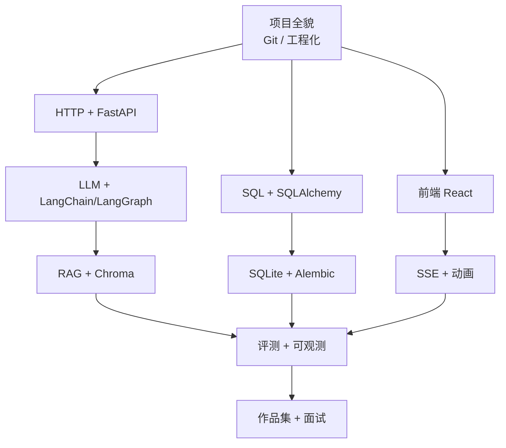

# 教学大纲 · 边做边学

> 项目：`ziwei-insight`
> 适用对象：有 Python 与 AI 基础，但不熟悉 FastAPI、SQL、前端框架；目标是用这个项目找工作。
> 教学原则：**慢、细、可运行、每步有验收**。不一次性丢大段代码。

---

## 0. 怎么上课

每节课固定 6 个环节，约 90 分钟：

| 环节 | 时间 | 做什么 |
|---|---|---|
| 1. 回顾 | 5 min | 上节课学了什么，今天要解决什么问题 |
| 2. 概念 | 20 min | 用图和类比讲清楚“为什么”，先不写代码 |
| 3. 最小示例 | 20 min | 10–30 行、能独立运行的小例子 |
| 4. 落到项目 | 30 min | 把示例改造成项目里的真实代码，逐行解释 |
| 5. 测试 | 10 min | 写一个能证明它工作的测试或命令 |
| 6. 复盘 | 5 min | 记录到工作日志，留下 1–3 个问题 |

**约定**

- 你随时可以打断问“为什么”，不理解的代码不往下走。
- 每节课结束，项目必须处于**可运行、测试通过**的状态。
- 不复制粘贴大段代码：先讲结构，再逐块写。
- 报错是教学内容的一部分，先一起读错误信息，再改。
- 每节课后更新 `docs/02-工作记录.md`，写 3 行：学了什么、做了什么、还有什么不懂。

---

## 1. 知识地图



| 模块 | 必须掌握 | 了解即可 |
|---|---|---|
| Git / 工程化 | 分支、提交、`.gitignore`、环境变量 | CI 细节 |
| FastAPI | 路由、Pydantic、依赖注入、异步、SSE、测试 | 高级中间件 |
| SQL | 表设计、主外键、索引、事务、JOIN | 查询优化器原理 |
| SQLAlchemy | ORM 模型、Session、关系、迁移 | 复杂继承映射 |
| React | 组件、props/state、hooks、请求、流式渲染 | SSR/Next.js |
| LLM | 消息角色、token、流式、Prompt、结构化输出 | 微调 |
| RAG | 切分、embedding、混合检索、引用、评测 | 图 RAG |
| 测试 | 单测、API 测试、E2E、评测集 | 模糊测试 |
| 安全 | 密钥、输入校验、Prompt 注入、隐私 | 渗透测试 |

---

## 2. 课程总表

> 50 节 × 约 1.5 小时 ≈ 75 小时。已有基础的部分可以合并或快速过；标 ★ 的是零基础重点。

### 模块 0 · 项目与工具（4 节）

| 编号 | 主题 | 产出 |
|---|---|---|
| 0.1 | 项目全貌、架构图、数据流 | 能画出“输入生辰 → 命盘 → RAG → 流式解读”的链路 |
| 0.2 | Git/GitHub：分支、提交、PR、`.gitignore` | 独立完成一次提交与推送 |
| 0.3 | Python 工程化：conda、依赖锁定、配置、日志 | 可复现的 `ziwei` 环境 |
| 0.4 | pytest 入门：断言、fixture、参数化 | 第一个通过的测试 |

### 模块 1 · HTTP 与 FastAPI（8 节，★）

| 编号 | 主题 | 产出 |
|---|---|---|
| 1.1 | HTTP、REST、JSON、状态码 | 用 `curl` 调通一个接口 |
| 1.2 | FastAPI 第一个应用、路由、路径/查询参数 | `/health`、`/hello/{name}` |
| 1.3 | Pydantic：请求体、响应模型、校验、错误 | 生辰输入模型与 422 错误 |
| 1.4 | 依赖注入、分层（api/service/domain）、异常处理 | 项目目录骨架 |
| 1.5 | async/await、事件循环、什么时候该异步 | 异步 vs 同步的对比示例 |
| 1.6 | SSE：`text/event-stream`、事件格式、心跳、断开 | 一个每秒推送的流式接口 |
| 1.7 | 中间件、CORS、限流、文件上传 | 前后端联调所需配置 |
| 1.8 | FastAPI 测试：`httpx.AsyncClient`、依赖覆盖 | 接口测试通过 |

### 模块 2 · SQL 与数据库（7 节，★）

| 编号 | 主题 | 产出 |
|---|---|---|
| 2.1 | 关系模型：表、行、列、主键、外键 | 画出 6 张表的 ER 图 |
| 2.2 | SQL 基础：SELECT/INSERT/UPDATE/DELETE/JOIN | 手写 10 条查询 |
| 2.3 | 索引、事务、ACID、锁、WAL | 理解为什么流式写库会锁 |
| 2.4 | SQLAlchemy 2.0：模型、类型、关系 | `sessions/charts/messages` 模型 |
| 2.5 | Session、查询、N+1、懒加载 | 会话详情查询 |
| 2.6 | Alembic：迁移、升级、回滚 | 第一次 migration |
| 2.7 | SQLite 特性、备份、测试隔离 | 测试用 `:memory:` |

### 模块 3 · 排盘领域（4 节）

| 编号 | 主题 | 产出 |
|---|---|---|
| 3.1 | 紫微斗数基础：十二宫、十四主星、四化、大限 | 术语表与数据模型 |
| 3.2 | `iztro-py`：输入、输出、归一化 | 第一张命盘 JSON |
| 3.3 | 真太阳时、闰月、子时换日 | 边界用例 |
| 3.4 | 黄金命盘与回归测试 | 5 张盘的断言 |

### 模块 4 · LLM 应用（7 节）

| 编号 | 主题 | 产出 |
|---|---|---|
| 4.1 | LLM API 基础：消息角色、token、temperature、上下文窗口 | 一次非流式调用 |
| 4.2 | DeepSeek：`deepseek-chat` / `deepseek-reasoner`、流式、`reasoning_content` | 命令行流式输出 |
| 4.3 | LangChain：`ChatDeepSeek`、Prompt、Runnable、LCEL | 最小链 |
| 4.4 | Prompt 工程、结构化输出、JSON 校验与修复 | 解读卡片 schema |
| 4.5 | LangGraph：状态、节点、边、条件分支 | 排盘→检索→推理→成文 |
| 4.6 | 工具调用、超时、重试、降级、成本预算 | reasoner → chat → 模板 |
| 4.7 | 可观测性：日志、token、延迟、trace | 一次解读的完整指标 |

### 模块 5 · RAG（6 节）

| 编号 | 主题 | 产出 |
|---|---|---|
| 5.1 | RAG 全貌、典型失败模式 | 能解释“检索错/生成幻觉/引用错” |
| 5.2 | 语料清洗、结构感知切分、元数据 | 第一批知识 JSONL |
| 5.3 | Embedding、向量相似度、Chroma | 本地索引与检索 |
| 5.4 | BM25、混合检索、RRF | 双路召回 |
| 5.5 | 引用、上下文预算、拒答 | `[K1]` 引用校验 |
| 5.6 | RAG 评测：Recall@k、RAGAS | 第一份评测报告 |

### 模块 6 · 前端（10 节，★）

| 编号 | 主题 | 产出 |
|---|---|---|
| 6.1 | HTML/CSS/JS 最小复习：DOM、事件、fetch | 静态命盘页 |
| 6.2 | TypeScript：类型、接口、泛型基础 | 命盘类型定义 |
| 6.3 | React：组件、props、state、条件渲染、列表 | 十二宫组件 |
| 6.4 | Hooks：`useState`、`useEffect`、`useMemo`、依赖数组 | 数据加载与缓存 |
| 6.5 | Vite 工程、Tailwind、目录结构 | 前端骨架 |
| 6.6 | 数据请求：TanStack Query、错误/加载状态 | 排盘请求 |
| 6.7 | SSE 前端：`fetch` 流、增量解析、批量渲染 | 流式解读面板 |
| 6.8 | Framer Motion：入场、错峰、布局动画 | 命盘点亮动画 |
| 6.9 | 命盘布局：CSS Grid、十二宫定位、响应式 | 完整命盘页 |
| 6.10 | 前端测试：Vitest、Playwright | 核心交互 E2E |

### 模块 7 · 质量与交付（4 节）

| 编号 | 主题 | 产出 |
|---|---|---|
| 7.1 | 测试策略、覆盖率、Mock、CI | 全链路测试 |
| 7.2 | 性能：首 token、P95、压测、缓存 | 性能报告 |
| 7.3 | 安全与隐私：密钥、注入、上传、日志脱敏 | 安全检查清单 |
| 7.4 | 作品集：README、演示视频、STAR 讲述 | 面试材料 |

---

## 3. 里程碑与课程的对应

| 里程碑 | 对应课程 | 完成后你能做什么 |
|---|---|---|
| M1 排盘内核 | 0.2–0.4、3.1–3.4 | 独立用 Python 排出一张盘并写回归测试 |
| M2 API + LLM | 1.1–1.8、4.1–4.4 | 写一个带流式输出的 FastAPI 服务 |
| M3 RAG + DB | 2.1–2.7、5.1–5.6 | 设计表、写迁移、搭混合检索 |
| M4 前端 | 6.1–6.10 | 用 React 做交互页面并接 SSE |
| M5 评测加固 | 4.5–4.7、7.1–7.3 | 给 LLM 应用做评测与降级 |
| M6 包装 | 7.4 | 讲清楚项目与取舍 |

---

## 4. 零基础模块的详细讲法

### 4.1 FastAPI 怎么讲

1. **先讲 HTTP**：浏览器发什么、服务器回什么、状态码是什么。
2. **再讲“框架帮你做了什么”**：路由匹配、参数解析、校验、序列化。
3. **每个概念配一个最小接口**：`/health` → `/charts` → `/charts/{id}`。
4. **Pydantic 单独讲**：为什么不用 `dict`，错误信息从哪来。
5. **异步单独讲**：`async def` 不是“更快”，而是“等待 IO 时让出线程”。
6. **SSE 单独讲**：为什么不用 WebSocket；事件格式；浏览器怎么收。
7. **测试单独讲**：不启动服务器也能测接口。

### 4.2 SQL 怎么讲

1. **先用 Excel 类比**：一张表 = 一个 sheet，一行 = 一条记录。
2. **手写 SQL**，不急着上 ORM：建表、插入、查询、JOIN。
3. **讲约束**：主键、外键、唯一、非空，分别防什么错。
4. **讲事务**：转账例子；为什么流式写库要用短事务。
5. **再上 SQLAlchemy**：ORM 只是把 SQL 映射成对象，底层仍是 SQL。
6. **讲迁移**：为什么不能直接改表；Alembic 的 upgrade/downgrade。
7. **讲 SQLite 的边界**：单机够用，并发写弱，WAL 解决什么。

### 4.3 React 怎么讲

1. **先讲“声明式”**：UI = f(state)，不要手动改 DOM。
2. **组件 = 函数**：输入 props，输出 JSX。
3. **state 是记忆**：`useState` 触发重渲染。
4. **副作用**：`useEffect` 什么时候跑、依赖数组怎么填。
5. **列表与 key**：为什么不能用 index。
6. **请求与状态**：loading / error / data 三态。
7. **流式渲染**：不要每个 token 都 setState，按 50ms 批量 flush。
8. **动画**：先讲 CSS transition，再讲 Framer Motion 的 `motion` 组件。

---

## 5. 每节课的验收方式

| 类型 | 验收 |
|---|---|
| 概念课 | 你能用自己的话解释，并指出项目里对应的文件 |
| 代码课 | 代码能跑，测试通过，能解释每一行 |
| 调试课 | 能读懂报错，定位到文件和行号 |
| 评测课 | 能解释指标含义，知道什么情况会失真 |
| 复盘 | 工作日志有 3 行记录，问题清单更新 |

**不通过的信号**：代码能跑但你说不出为什么；测试是复制的；报错靠猜。出现这些就停下来重讲。

---

## 6. 学习记录模板

每节课后追加到 `docs/02-工作记录.md`：

```markdown
### 课程 X.Y · 主题

- 今天解决的问题：
- 新概念（3 个以内）：
- 写的代码/文件：
- 测试/验证：
- 还没懂的问题：
- 下节课前要做的准备：
```

---

## 7. 常见误区（提前打预防针）

1. **“先让 AI 把代码全写了，我以后再看”**——看不懂的代码不会变成你的能力；本项目每段代码都要能讲。
2. **“SQL 用 ORM 就不用学”**——ORM 出错时还是要看 SQL；表设计错了 ORM 救不了。
3. **“React 就是写 JSX”**——核心是状态与渲染关系；状态设计错了，动画再炫也没用。
4. **“RAG 就是向量检索”**——切分、混合召回、重排、引用、评测，任何一环都能让效果崩。
5. **“流式就是加个 stream=True”**——还要处理首 token、增量解析、断线、降级、前端批量渲染。
6. **“测试是浪费时间”**——这个项目里排盘和规则是确定性的，测试是你能证明“算对了”的唯一方式。

---

## 8. 进度跟踪

| 模块 | 节数 | 状态 | 备注 |
|---|---|---|---|
| 0 项目与工具 | 4 | 已完成 | 0.2/0.3 合并速记；0.1/0.4 已讲；笔记见 `06-学习笔记.md` |
| 1 FastAPI | 8 | 未开始 | 零基础重点 |
| 2 SQL | 7 | 未开始 | 零基础重点 |
| 3 排盘领域 | 4 | 未开始 | 结合参考仓库 |
| 4 LLM | 7 | 未开始 | 有 AI 基础可加速 |
| 5 RAG | 6 | 未开始 | 项目核心亮点 |
| 6 前端 | 10 | 未开始 | 零基础重点 |
| 7 质量与交付 | 4 | 未开始 | 最后做 |

> 更新方式：每完成一节课，把状态改为“进行中/已完成”，并在工作日志追加记录。
